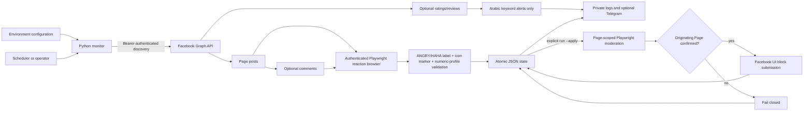

# Architecture

## Runtime components

- `reaction_defense.py` is the command-line entrypoint for configuration, monitoring, state inspection, explicit moderation, retry, and reconciliation.
- The Graph API discovers Page posts, optional comments, and optional ratings/reviews. Page tokens come from `META_PAGES_JSON` and travel in bearer headers. Graph is not used to enumerate other users' reactions.
- Playwright is required during monitoring. Its authenticated, bounded reaction-browser scan requires each enabled reaction's visible label and icon-source marker, then accepts only numeric profile links. The same browser boundary performs moderation only when `--apply` is explicit.
- A versioned JSON document is the local source of truth for observation and Page/account action state. A nonblocking POSIX lock serializes access; writes use a restricted temporary file and atomic replacement.
- Telegram is an optional summary channel. Delivery neither controls state nor authorizes moderation.

## Processing model

Ratings are checked first when enabled and remain alert-only. Each Page then receives a share of the Graph request ceiling and the total Playwright reaction-browser page ceiling. Graph discovers a bounded, fixed-order set of posts and optional comments. Playwright visits each corresponding reaction-browser route and keeps at most `MAX_REACTION_ACTORS_PER_OBJECT` unique numeric accounts whose visible label and icon-source marker both match their configured reaction.

Repeated Page/account observations update one target rather than creating repeated work. Detection-only still performs authenticated browser reads, then stops after local state and notifications without changing Facebook. Explicit `run --apply` selects at most `MAX_MODERATION_ACTIONS_PER_RUN` pending targets and revalidates the originating Page before each action.

Failed work is not silently retried. `retry-failed --confirm RETRY_FAILED_ACTIONS` requeues only eligible pre-confirmation failures. Interrupted `applying` records and ambiguous `uncertain` outcomes require Page-side reconciliation with `incomplete` and `resolve-incomplete`.

## State and idempotency

The JSON state contains a strict `version` field plus bounded ratings, observations, and action records derived from third-party input. Monitoring uses `DEFENSE_STATE_PATH`; state-management subcommands can override that default with `--state`. The containing directory, state file, sidecar lock, backups, and logs are private.

A lock prevents concurrent monitor, apply, retry, and reconciliation processes from publishing conflicting state. Each completed mutation is serialized to a mode-`0600` temporary file in the same directory, flushed, and atomically replaced. A Facebook UI action and the following local state write cannot form one transaction, so ambiguous outcomes remain isolated for manual reconciliation; exactly-once behavior across systems is not claimed.

## Trust boundaries

| Boundary | Control |
|---|---|
| Environment → monitor | Exact object keys, strict JSON, allowed enums, bounded numbers, normalized paths |
| Graph → monitor | Fixed HTTPS origin, bearer header, redirect refusal, timeout, size and pagination limits, strict response shapes |
| Facebook UI → Playwright | Private authenticated state, exact label/icon-marker matching, bounded pages and actors, numeric profile validation, Page confirmation |
| Monitor → JSON/logs | Nonblocking lock, strict schema, atomic replacement, mode `0600`, minimized output |
| Monitor → Telegram | Optional delivery, bounded configuration, no authorization based on delivery |

## External compatibility limits

Current Meta documentation does not support enumeration of other users' reactions through the Graph API for this workflow. Reaction discovery therefore depends on Facebook's mbasic reaction-browser route. Its URL, labels, icon-source markers, pagination text, selectors, and comment-object compatibility require authorized live validation. Fixed-order bounded traversal can defer later objects during sustained early-page volume; the system does not claim exhaustive coverage beyond configured ceilings.
